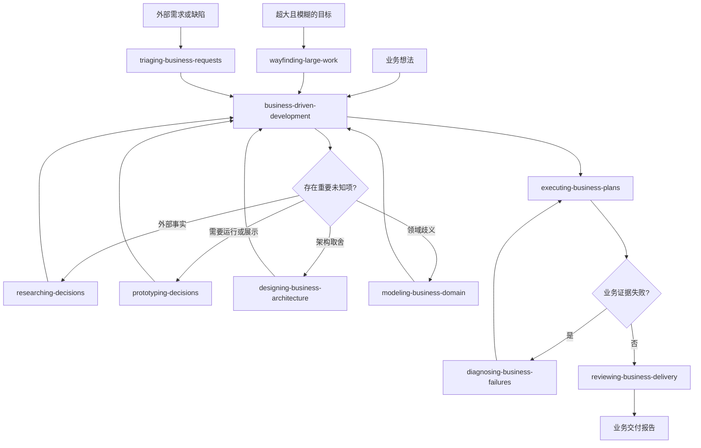

# Easypower Skill 能力地图

本文定义 Easypower 计划建设的正式 Skill、参考来源和能力边界。它是演进地图，不要求一次完成所有 Skill，也不按参考仓库目录逐个复刻。

## 一、设计原则

1. **业务结果优先**：规划、实现、调试和评审都先回答业务目标是否成立。
2. **默认显式调用**：正式 Skill 默认设置 `allow_implicit_invocation: false`。用户或上游 Skill 明确调用时才加载。
3. **一个 Skill 解决一个可重复问题**：只有需要独立触发、独立验证和独立上下文的能力才成为 Skill。
4. **机制可以内嵌**：TDD、worktree、handoff、并行调度和完成验证可以作为内部协议，不必全部暴露为 Skill。
5. **渐进式披露**：主 `SKILL.md` 保留选择和状态机，详细协议按需读取。
6. **逐个验证**：每个新 Skill 都先观察无 Skill 基线，再编写最小版本并前向测试。

Easypower 不提供“每轮对话都先运行”的全局路由 Skill。Skill 发现依赖清晰的名称、描述和仓库文档，不依赖强制启动流程。

## 二、正式 Skill 规划

| Skill | 类型 | 状态 | 调用方式 | 解决的问题 |
|---|---|---|---|---|
| `business-driven-development` | 主流程 | 已完成 | 用户显式调用 | 从业务想法形成已批准 Spec、渐进式 Plan 和自治边界 |
| `executing-business-plans` | 执行 | 已完成 | 用户或主流程显式调用 | 在全新上下文中按执行前沿持续完成已批准 Plan |
| `designing-business-architecture` | 决策支持 | 已完成 | 用户或主流程显式调用 | 围绕业务负载比较接口、计算、存储和系统架构方案 |
| `diagnosing-business-failures` | 质量保障 | 已完成 | 用户或执行流程显式调用 | 从业务失败证据建立反馈循环、定位根因并防止回归 |
| `reviewing-business-delivery` | 质量保障 | 已完成 | 用户或执行流程显式调用 | 分别审查业务契约符合度和工程风险，并汇总交付证据 |
| `prototyping-decisions` | 决策支持 | P2 | 用户或主流程显式调用 | 用一次性逻辑或 UI 原型回答无法靠文字解决的问题 |
| `researching-decisions` | 决策支持 | P2 | 用户或主流程显式调用 | 基于第一方资料调查事实并留下可引用结论 |
| `modeling-business-domain` | 决策支持 | P2 | 用户或主流程显式调用 | 统一业务语言、具体场景和少量真正必要的 ADR |
| `wayfinding-large-work` | 主流程入口 | P2 | 用户显式调用 | 为超过一个上下文的大型模糊工作维护决策地图和未知前沿 |
| `triaging-business-requests` | 需求入口 | P3 | 用户显式调用 | 验证外部需求或缺陷，并形成可交给 Agent 的业务 Brief |

P1 补齐核心交付闭环，P2 处理复杂决策和超大范围，P3 处理团队需求入口。优先级可以根据真实使用反馈调整，但每次只创建和验证一个 Skill。

## 三、能力关系

上图描述调用关系，不代表每个任务都要经过全部 Skill。没有重要未知项时直接跳过决策支持；低风险切片也不要求独立评审 Skill。

## 四、来源能力映射

### Superpowers 中文译版

| 来源能力 | Easypower 去向 | 处理方式 |
|---|---|---|
| `using-superpowers` | 无正式对应 | 删除全局启动路由，不继承“1% 可能就调用” |
| `brainstorming` + `writing-plans` | `business-driven-development` | 合并为业务 Spec 和渐进式 Plan，两次用户审批 |
| `subagent-driven-development` + `executing-plans` + `dispatching-parallel-agents` | `executing-business-plans` | 合并为依赖前沿、任务所有权和后台自治执行 |
| `test-driven-development` | 风险验证协议 | 不作为所有实现的强制 Skill；复杂核心逻辑按需使用测试先行 |
| `systematic-debugging` | `diagnosing-business-failures` | 保留根因分析，起点改为可复现的业务失败证据 |
| `requesting-code-review` + `receiving-code-review` | `reviewing-business-delivery` | 合并请求、判断反馈和复验，业务符合度优先 |
| `verification-before-completion` | 执行和评审内部协议 | 保留证据原则，验证范围按业务风险选择 |
| `using-git-worktrees` + `finishing-a-development-branch` | 执行内部操作规则 | 隔离、提交、合并和清理由环境及授权决定 |
| `writing-skills` | 仓库贡献规范 | 用于建设 Easypower，不作为日常业务开发 Skill 发布 |

### mattpocock-skill

| 来源能力 | Easypower 去向 | 处理方式 |
|---|---|---|
| `grill-with-docs` + `to-spec` + `to-tickets` | `business-driven-development` | 吸收逐项决策、领域语言、垂直切片和依赖边 |
| `implement` | `executing-business-plans` | 改为业务切片循环和按风险验证，不默认全量 TDD |
| `codebase-design` + `improve-codebase-architecture` | `designing-business-architecture` | 吸收深模块、接口、局部性、Design It Twice，并补充性能负载分析 |
| `diagnosing-bugs` | `diagnosing-business-failures` | 吸收最小复现、假设、仪器化和回归证据 |
| `code-review` | `reviewing-business-delivery` | 将 Spec 轴升级为业务契约轴，工程轴按风险审查 |
| `prototype` | `prototyping-decisions` | 保留“一次性代码只回答一个问题” |
| `research` | `researching-decisions` | 保留第一方来源和后台调查 |
| `domain-modeling` | `modeling-business-domain` | 保留术语、场景和稀疏 ADR，避免实现细节污染业务语言 |
| `wayfinder` | `wayfinding-large-work` | 保留决策票据、未知前沿和跨上下文地图 |
| `triage` | `triaging-business-requests` | 从 issue 状态机改为业务价值、可复现性和 Agent-ready Brief |
| `handoff` | 执行内部上下文协议 | 权威文件链接和任务 Brief 代替复制整段会话 |
| `ask-matt` | 无正式对应 | 不创建强制路由；由能力地图和显式调用完成发现 |

## 五、不单独创建的 Skill

以下机制当前不值得独立占用触发入口：

| 机制 | 原因 | 所属位置 |
|---|---|---|
| 通用 TDD | 不是所有改动都值得测试先行 | 执行、诊断中的风险策略 |
| 完成前验证 | 所有交付都需要证据，但验证强度不同 | 执行和评审的完成门 |
| 并行代理调度 | 是执行策略，不是用户目标 | `executing-business-plans` |
| Git worktree 与分支收尾 | 依赖平台、仓库和用户授权 | 执行内部操作规则 |
| 接收评审意见 | 与发起评审属于同一交付闭环 | `reviewing-business-delivery` |
| Conversation handoff | 权威文档和 Agent Brief 已承担主要职责 | 各主流程内部协议 |
| Skill 路由器 | 容易恢复每轮强制触发 | README、能力地图和精确 description |

如果真实使用证明某个内嵌机制需要独立调用、独立上下文或独立评估，再从内部协议提升为正式 Skill。

## 六、推荐建设顺序

### P1：补齐核心交付闭环

1. `executing-business-plans`（已完成）：把已批准 Plan 交给全新上下文持续执行，是后台自治的核心。
2. `designing-business-architecture`（已完成）：补足性能、接口、存储和系统级取舍，直接改善 Spec 与 Plan 质量。
3. `diagnosing-business-failures`（已完成）：为执行失败建立可靠恢复路径。
4. `reviewing-business-delivery`（已完成）：在最终交付前独立检查业务契约和工程风险。

`executing-business-plans` 已完成三个隔离前向场景和一次规划到执行的组合测试。`business-driven-development` 负责形成授权，执行 Skill 负责消费授权；规划会话和长时间执行会话使用不同上下文。

`designing-business-architecture` 已完成 BI 负载、定价模块边界和渐进存储演进三个隔离前向场景。它作为规划阶段的按需决策分支，不成为每个功能的固定步骤。

`diagnosing-business-failures` 已完成黄金报表差异、低概率重复扣款和性能退化三个隔离前向场景。它区分生产止损、根因修复和业务恢复证据，并由执行流程在失败时显式调用。

`reviewing-business-delivery` 已完成业务契约失败、工程风险阻断和低风险反馈核验三个隔离前向场景。它不要求每个切片固定双代理评审，并把业务契约轴和工程风险轴分别报告。

### P2：提高复杂决策质量

依次建设 `prototyping-decisions`、`researching-decisions`、`modeling-business-domain` 和 `wayfinding-large-work`。顺序由最常出现的真实问题决定。

### P3：扩展团队入口

当 Easypower 开始处理外部 issue、PR 或需求池时，再建设 `triaging-business-requests`，避免提前绑定某个 issue tracker。

## 七、正式 Skill 准入条件

一个候选目录只有满足以下条件才可以加入 `skills/`：

- 用户问题和触发语句具体；
- 与现有 Skill 的职责不重叠；
- 默认调用策略已经确定；
- 至少三个基线场景暴露出可重复失败；
- 最小 Skill 能显著改善相同场景；
- 参考文件只承载按需细节，没有重复主入口；
- OpenAI 元数据、链接和 frontmatter 校验通过；
- 与上游/下游 Skill 的输入输出契约明确。

准入完成后，在本文更新状态和真实验证结果，而不是只标记“文档已写”。
