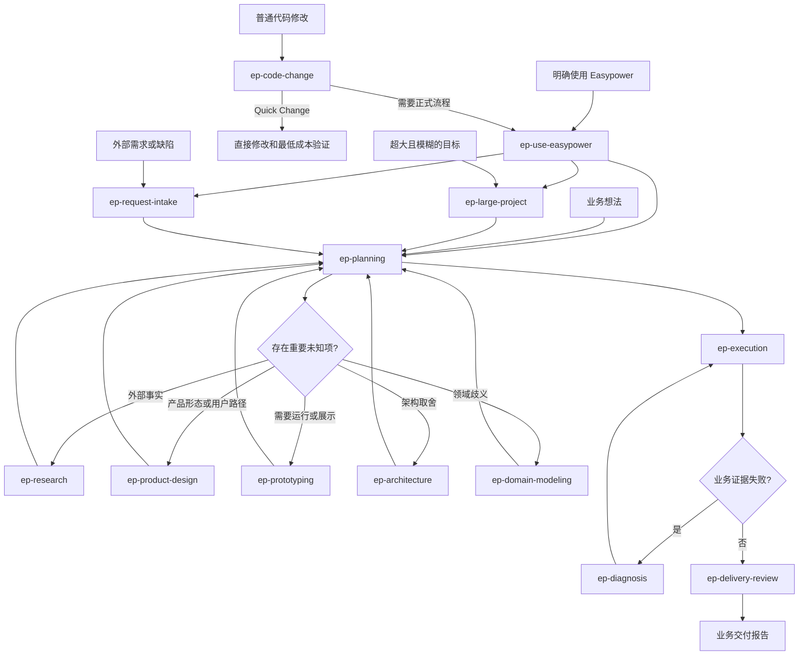

# Easypower Skill 能力地图

本文定义 Easypower 计划建设的正式 Skill、参考来源和能力边界。它是演进地图，不要求一次完成所有 Skill，也不按参考仓库目录逐个复刻。

## 一、设计原则

1. **业务结果优先**：规划、实现、调试和评审都先回答业务目标是否成立。
2. **业务流程默认显式调用**：会启动规划、执行或决策流程的 Skill 设置 `allow_implicit_invocation: false`。轻量横切约束可以明确允许隐式调用。
3. **一个 Skill 解决一个可重复问题**：只有需要独立触发、独立验证和独立上下文的能力才成为 Skill。
4. **机制可以内嵌**：TDD、worktree、handoff、并行调度和完成验证可以作为内部协议，不必全部暴露为 Skill。
5. **渐进式披露**：主 `SKILL.md` 保留选择和状态机，详细协议按需读取。
6. **逐个验证**：每个新 Skill 都先观察无 Skill 基线，再编写最小版本并前向测试。

Easypower 不提供“每轮对话都先运行”的重型路由流程。`ep-use-easypower` 只在用户明确要求使用 Easypower 时选择一个下游 Skill；`ep-code-change` 可以自动触发，但只区分快速修改与正式流程，不编写 Spec 或 Plan。

`ep-code-change` 和 `ep-chinese-writing` 都是简短的高频隐式 Skill。前者约束代码修改的流程与验证成本，后者只约束输出表达。

## 二、正式 Skill 规划

| Skill | 类型 | 状态 | 调用方式 | 解决的问题 |
|---|---|---|---|---|
| `ep-use-easypower` | 总入口 | 已完成 | 用户显式调用或明确指定 Easypower | 根据上下文选择最小且足够的 Easypower 流程 |
| `ep-code-change` | 轻量守门 | 已完成 | 代码或局部开发操作默认触发 | 快速完成局部修改，复杂任务升级总入口 |
| `ep-planning` | 主流程 | 已完成 | 用户显式调用 | 从业务想法形成已批准 Spec、渐进式 Plan 和自主执行边界 |
| `ep-execution` | 执行 | 已完成 | 用户或主流程显式调用 | 在全新上下文中按 Frontier（当前可执行任务）持续完成已批准 Plan |
| `ep-architecture` | 决策支持 | 已完成 | 用户或主流程显式调用 | 围绕业务负载比较接口、计算、存储和系统架构方案 |
| `ep-diagnosis` | 质量保障 | 已完成 | 用户或执行流程显式调用 | 从业务故障证据建立反馈闭环、定位根因并防止回归 |
| `ep-delivery-review` | 质量保障 | 已完成 | 用户或执行流程显式调用 | 分别审查业务契约符合度和工程风险，并汇总交付证据 |
| `ep-prototyping` | 决策支持 | 已完成 | 用户或主流程显式调用 | 用一次性逻辑或 UI 原型回答无法靠文字解决的问题 |
| `ep-research` | 决策支持 | 已完成 | 用户或主流程显式调用 | 基于第一方资料调查事实并留下可引用结论 |
| `ep-domain-modeling` | 决策支持 | 已完成 | 用户或主流程显式调用 | 统一业务语言、具体场景和少量必要的 ADR |
| `ep-large-project` | 主流程入口 | 已完成 | 用户显式调用 | 为超过一个上下文的大型模糊工作维护决策地图和未知前沿 |
| `ep-request-intake` | 需求入口 | 已完成 | 用户显式调用 | 验证外部需求或缺陷，并形成可交给规划流程的 Business Brief |
| `ep-product-design` | 决策支持 | 已完成 | 用户或主流程显式调用 | 基于用户证据和多角色任务走查确定可批准的产品形态 |
| `ep-orchestration` | 执行支持 | 已完成 | 用户显式调用 | 用真实子代理、DAG 和持久化状态运行多角色工作流 |
| `ep-chinese-writing` | 表达约束 | 已完成 | 默认隐式调用 | 让中文解释和工程文档保留准确术语，并避免英文直译腔 |

P1 补齐核心交付闭环，P2 处理复杂决策和超大范围，P3 处理团队需求入口。优先级可以根据真实使用反馈调整，但每次只创建和验证一个 Skill。

## 三、能力关系

上图描述调用关系，不代表每个任务都要经过全部 Skill。没有重要未知项时直接跳过决策支持；低风险切片也不要求独立评审 Skill。

`ep-orchestration` 是独立的通用编排入口，不替代业务主流程。角色步骤可以调用适合的决策支持 Skill，已批准 Plan 的代码执行仍交给 `ep-execution`。

`ep-product-design` 定义产品体验方法和角色契约；需要多角色独立评审时调用 `ep-orchestration`，需要实际操作后判断时调用 `ep-prototyping`。三者不互相复制职责。

## 四、来源能力映射

### Superpowers 中文译版

| 来源能力 | Easypower 去向 | 处理方式 |
|---|---|---|
| `using-superpowers` | 无正式对应 | 删除全局启动路由，不继承“1% 可能就调用” |
| `brainstorming` + `writing-plans` | `ep-planning` | 合并为业务 Spec 和渐进式 Plan，两次用户审批 |
| `subagent-driven-development` + `executing-plans` + `dispatching-parallel-agents` | `ep-execution` | 合并为依赖前沿、任务所有权和后台自治执行 |
| `test-driven-development` | 风险验证协议 | 不作为所有实现的强制 Skill；复杂核心逻辑按需使用测试先行 |
| `systematic-debugging` | `ep-diagnosis` | 保留根因分析，起点改为可复现的业务故障证据 |
| `requesting-code-review` + `receiving-code-review` | `ep-delivery-review` | 合并请求、判断反馈和复验，业务符合度优先 |
| `verification-before-completion` | 执行和评审内部协议 | 保留证据原则，验证范围按业务风险选择 |
| `using-git-worktrees` + `finishing-a-development-branch` | 执行内部操作规则 | 隔离、提交、合并和清理由环境及授权决定 |
| `writing-skills` | 仓库贡献规范 | 用于建设 Easypower，不作为日常业务开发 Skill 发布 |

### mattpocock-skill

| 来源能力 | Easypower 去向 | 处理方式 |
|---|---|---|
| `grill-with-docs` + `to-spec` + `to-tickets` | `ep-planning` | 吸收逐项决策、领域语言、垂直切片和依赖边 |
| `implement` | `ep-execution` | 改为业务切片循环和按风险验证，不默认全量 TDD |
| `codebase-design` + `improve-codebase-architecture` | `ep-architecture` | 吸收深模块、接口、局部性、Design It Twice，并补充性能负载分析 |
| `diagnosing-bugs` | `ep-diagnosis` | 吸收最小复现、假设、仪器化和回归证据 |
| `code-review` | `ep-delivery-review` | 分开检查业务契约和工程风险，不合成一个总分 |
| `prototype` | `ep-prototyping` | 保留“一次性代码只回答一个问题” |
| `research` | `ep-research` | 保留第一方来源和后台调查 |
| `domain-modeling` | `ep-domain-modeling` | 保留术语、场景和稀疏 ADR，避免实现细节污染业务语言 |
| `wayfinder` | `ep-large-project` | 保留决策票据、未知前沿和跨上下文地图 |
| `triage` | `ep-request-intake` | 从 issue 状态机改为业务价值、可复现性和规划就绪的 Business Brief |
| `handoff` | 执行内部上下文协议 | 权威文件链接和 Agent Brief（任务说明）代替复制整段会话 |
| `ask-matt` | `ep-use-easypower` | 只吸收按上下文发现能力的思想，不复制人格入口或每轮强制触发 |

### jnMetaCode Agent 生态

| 来源能力 | Easypower 去向 | 处理方式 |
|---|---|---|
| `workflow-runner` | `ep-orchestration` | 保留 YAML DAG、角色契约和分层并行；改为真实子代理、持久化状态、所有权检查和用户 Decision Gate |
| `agency-orchestrator` + `agency-agents-zh` | `ep-product-design` | 吸收角色、方法和工作流分离；用证据和权限契约代替大规模人格角色库 |

## 五、不单独创建的 Skill

以下机制当前不值得独立占用触发入口：

| 机制 | 原因 | 所属位置 |
|---|---|---|
| 通用 TDD | 不是所有改动都值得测试先行 | 执行、诊断中的风险策略 |
| 完成前验证 | 所有交付都需要证据，但验证强度不同 | 执行和评审的完成条件 |
| 并行代理调度 | 是执行策略，不是用户目标 | `ep-execution` |
| Git worktree 与分支收尾 | 依赖平台、仓库和用户授权 | 执行内部操作规则 |
| 接收评审意见 | 与发起评审属于同一交付闭环 | `ep-delivery-review` |
| Conversation handoff | 权威文档和 Agent Brief 已承担主要职责 | 各主流程内部协议 |

如果真实使用证明某个内嵌机制需要独立调用、独立上下文或独立评估，再从内部协议提升为正式 Skill。

## 六、推荐建设顺序

### P1：补齐核心交付闭环

1. `ep-execution`（已完成）：把已批准 Plan 交给全新上下文持续执行，是后台自治的核心。
2. `ep-architecture`（已完成）：补足性能、接口、存储和系统级取舍，直接改善 Spec 与 Plan 质量。
3. `ep-diagnosis`（已完成）：为执行失败建立可靠恢复路径。
4. `ep-delivery-review`（已完成）：在最终交付前独立检查业务契约和工程风险。

`ep-execution` 已完成三个隔离前向场景和一次规划到执行的组合测试。`ep-planning` 负责形成授权，执行 Skill 负责消费授权；规划会话和长时间执行会话使用不同上下文。

`ep-architecture` 已完成 BI 负载、定价模块边界和渐进存储演进三个隔离前向场景。它作为规划阶段的按需决策分支，不成为每个功能的固定步骤。

`ep-diagnosis` 已完成基准报表差异、低概率重复扣款和性能退化三个隔离前向场景。它区分生产止损、根因修复和业务恢复证据，并由执行流程在失败时显式调用。

`ep-delivery-review` 已完成业务契约失败、工程风险阻断和低风险反馈核验三个隔离前向场景。它不要求每个切片固定双代理评审，并分别报告业务契约检查和工程风险检查。

### P2：提高复杂决策质量

`ep-prototyping` 已完成业务逻辑口径、现有页面 UI 方案和供应商能力工具选择三个隔离前向场景。它只回答必须运行后才能判断的一个问题，并将外部事实显式交给 `$ep-research`。

`ep-research` 已完成供应商能力、未指定框架升级和具体 Excel 算法等价三个隔离前向场景。它固定对象坐标、优先一手来源并严格区分事实、推论、建议和未知项。

`ep-domain-modeling` 已完成 SaaS “账号”歧义、报表定义/计算/发布混用和 ADR 过度记录三个隔离前向场景。它用具体场景确认业务语言和不变量，将结论回写 Spec，并保持上下文地图与 ADR 稀疏。

`ep-large-project` 已完成 ERP 替换、模糊 BI 平台统一和清晰小功能三个前向场景。它只服务于跨上下文且无法直接形成 Spec 的目标，维护 Decision Map（决策地图）、Decision Ticket（决策票据）、Frontier（决策前沿）和 Fog（待澄清区域），路线清楚后交给 `ep-planning`。

### P3：扩展团队入口

`ep-request-intake` 已完成证据不足的退款报表缺陷、方案先行的 Kafka 请求和合同批量操作三个前向场景。它不绑定某个 issue tracker，先验证项目事实与业务价值，再以单一状态形成 Business Brief；清晰请求进入规划，大型模糊请求进入 Wayfinding，活跃故障进入诊断。

### P4：统一中文表达

`ep-chinese-writing` 覆盖用户解释、Spec、Plan 和工程文档。它保留专业英文，在首次出现时补充中文意译，并保持后续用词一致；其内容保持简短，不引入额外流程。

### P5：多角色工作流编排

`ep-orchestration` 吸收声明式 YAML 工作流、角色定义和 DAG 分层执行，并补上真实子代理、文件所有权、运行状态、失败传播和跨会话恢复。它服务于通用多角色评审、研究和决策，不接管已批准业务 Plan 的实现。

### P6：产品体验塑造

`ep-product-design` 补足 Spec 前的用户路径、信息层级和产品形态决策。它使用 Product Lead、User Advocate、Interaction Designer 和 Architect 的责任契约进行有限轮次评审；Agent 不能冒充真实用户，无法区分的方案转入用户证据或 Prototype（原型验证）。

### P7：统一入口与快速修改

`ep-use-easypower` 为用户提供单一显式入口，只选择一个最先阻止业务推进的下游 Skill。`ep-code-change` 在普通代码修改时自动触发；它不按权限、金额或状态等词语机械升级，而是根据业务决策、影响范围、可恢复性和上下文规模判断是否需要正式流程。

当前能力地图中的十五个正式 Skill 已全部完成。后续候选能力只从真实使用反馈中产生，不为了覆盖参考仓库目录继续扩张。

## 七、正式 Skill 准入条件

一个候选目录只有满足以下条件才可以加入 `skills/`：

- 用户问题和触发语句具体；
- 与现有 Skill 的职责不重叠；
- 默认调用策略已经确定；
- 至少三个基线场景暴露出可重复失败；
- 最小 Skill 能显著改善相同场景；
- 参考文件只承载按需细节，没有重复主入口；
- OpenAI 元数据、链接和 frontmatter 校验通过；
- 与上游/下游 Skill 的输入输出契约明确。

准入完成后，在本文更新状态和真实验证结果，而不是只标记“文档已写”。
