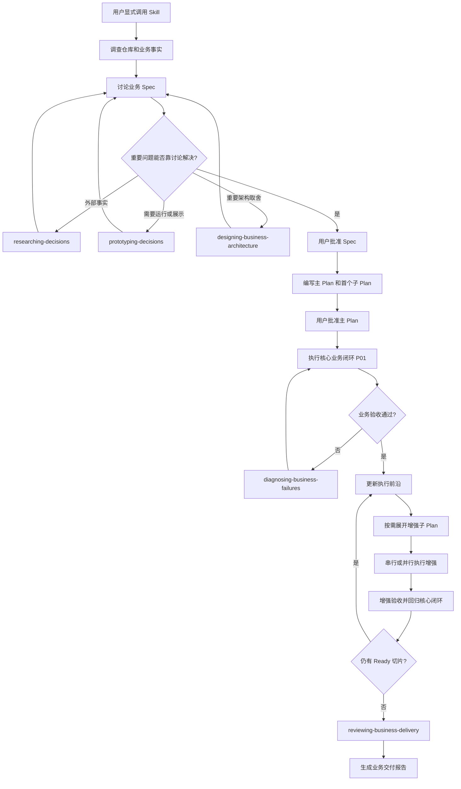

# Easypower 工作流

本文描述 Easypower 当前已完成的第一条业务驱动开发主流程。后续正式 Skill 会继续加入 `skills/`，但不会因为来源仓库存在某个 Skill 就机械复制。

完整 Skill 边界和建设顺序见 [Easypower Skill 能力地图](SKILL-MAP.md)。

## 一、目标

Easypower 面向需要先审核 Spec 和 Plan、再交给 Code Agent 或子代理持续执行的业务开发任务。

它以可验收的业务结果作为控制单位：

- Spec 固定业务目标和验收契约；
- 主 Plan 固定业务切片、依赖和自治边界；
- 子 Plan 在进入执行前沿时按最新代码展开；
- Agent 在批准范围内自主实现，重大变化升级给用户；
- 完成结论由业务证据支持，而不是由测试数量支持。

## 二、默认入口

当前第一个正式入口是 [business-driven-development](skills/business-driven-development/SKILL.md)。

该 Skill 禁止隐式调用。用户需要通过 `$business-driven-development` 或等价的显式 Skill 调用启动完整流程。普通问答、简单修改和状态检查不自动进入该工作流。



## 三、Spec

Spec 是业务事实来源，回答：

- 为什么做；
- 谁使用；
- 最小业务闭环是什么；
- 哪些业务规则和不变量必须成立；
- 哪些增强能力纳入本次交付；
- 如何判断每项业务结果正确；
- 哪些内容明确不做。

仓库或数据中能够查明的事实由 Agent 调查。业务口径、范围和取舍由 Agent 提出推荐，用户确认。

业务方没有提供目标文件时，Agent 应通过输入输出样例、决策表、权限矩阵、状态转换、业务不变量或用户可观察结果构造验收契约。

详细规则见 [Spec 协议](skills/business-driven-development/references/spec-protocol.md)。

## 四、决策分支

只有重要未知项无法通过普通讨论可靠解决时，才使用以下分支：

| 分支 | 适用问题 | 产物 |
|---|---|---|
| `researching-decisions` | 依赖官方文档、规范或外部事实 | 有来源的结论 |
| `prototyping-decisions` | 状态、计算或交互需要运行后判断 | 一次性原型和验证结论 |
| `designing-business-architecture` | 公共接口、数据模型、计算、存储或迁移架构难以逆转 | 业务负载、多个方案、取舍、迁移和批准决定 |

分支产物用于消除决策歧义，不直接替代生产实现。

## 五、渐进式 Plan

Plan 使用三层结构：

```text
Spec
  -> 主 Plan：全局执行地图
      -> 子 Plan：当前业务切片的实现与验收
          -> Agent Brief：单个执行代理的最小上下文
```

主 Plan 保持短小，包含：

- 业务切片及其验收摘要；
- 依赖图和执行前沿；
- 核心业务闭环里程碑；
- 并行与所有权边界；
- 全局回归要求；
- 自治、停止和恢复规则。

大型功能不在最初写完所有子 Plan。主 Plan 批准时确定所有切片的目标、依赖和验收；某个切片进入执行前沿时，再根据最新代码展开详细子 Plan。

Plan 可以包含少量代码。只有删除片段会导致执行者对重要业务或架构决定产生不同理解时，才保留公式、伪代码、Schema、状态机、公共接口或性能关键逻辑。普通实现留给执行 Agent。

详细规则见 [Plan 协议](skills/business-driven-development/references/plan-protocol.md)。

## 六、业务切片

每个切片交付一条可独立验收的端到端业务能力。数据库、后端、前端和测试通常是同一切片中的实施步骤，而不是四个互不产生业务结果的任务。

推荐顺序：

1. P01 完成最小核心业务闭环；
2. P01 取得直接业务证据；
3. 计算、展示、存储或运行增强进入执行前沿；
4. 独立增强在所有权不冲突时并行；
5. 每项增强验收后回归 P01；
6. 所有切片完成后进行适合影响范围的集成验证。

## 七、测试和验证

测试服务于业务判断，不作为工作量指标。

| 变化 | 推荐验证 |
|---|---|
| 文档、文案、低风险配置 | 格式、差异或针对性检查 |
| 普通业务切片 | 切片验收和核心闭环回归 |
| 金额、权限、状态、数据一致性 | 代表性场景、关键边界和集成验证 |
| 公共接口、迁移、基础设施 | 受影响消费者、构建、回滚和更广回归 |
| 性能增强 | 结果等价和固定工作负载下的前后基准 |

优先在最高稳定的业务接口验证。同一业务结果已有高层证据时，不在每个内部代码层重复测试。复杂公式、算法、状态转换和历史回归可以保留针对性单元测试。

## 八、自主执行

只有 Spec 和主 Plan 都获得明确批准，才进入无人值守执行。

Agent 可以自主：

- 展开不改变已批准契约的子 Plan；
- 选择可逆的等价实现；
- 修复局部实现缺陷；
- 调度依赖已满足且所有权不冲突的任务；
- 在失败后继续其他独立执行前沿。

Agent 必须升级审批：

- 改变业务范围、验收标准或不变量；
- 改变公共接口、数据模型或关键架构；
- 出现多个合理但证据无法区分的业务解释；
- 需要新的外部权限、生产操作或不可恢复动作；
- 主 Plan 未覆盖的系统性风险使原授权不再充分。

详细规则见 [executing-business-plans](skills/executing-business-plans/SKILL.md)。

## 九、交付报告

最终报告按 Spec 逐项说明：

- 哪个业务目标完成；
- 使用了什么输入和运行方式；
- 预期结果与实际结果如何比较；
- 每个增强带来了什么变化；
- 核心业务闭环是否持续成立；
- 计划发生了哪些经批准或未解决的偏差；
- 代码、数据、截图、日志和基准等证据位于哪里。

“测试通过”可以成为证据的一部分，但不能替代业务结论。

## 十、参考源与后续 Skill

旧 Superpowers 中文译版已经移动到 `references/superpowers-zh/skills/`，仅用于研究、比较和逐步吸收成熟机制：

- `using-superpowers`
- `brainstorming`
- `writing-plans`
- `test-driven-development`
- `subagent-driven-development`
- 其余调试、评审、验证和分支管理 Skill

这些目录不属于 Skill 发布路径，不应安装或参与自动发现。

后续每个 Easypower Skill 都应满足：

1. 对应一个独立、可重复出现的实际工作问题；
2. 触发条件足够窄，不因普通对话频繁启动；
3. 明确它与业务目标、主流程和其他 Skill 的关系；
4. 先观察没有该 Skill 时的失败行为；
5. 编写最小 Skill 后使用相同场景前向验证；
6. 验证通过后才加入 `skills/`。

`business-driven-development` 是第一项成果，不代表 Easypower 最终只包含一个 Skill。
