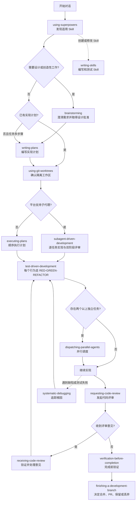

# 14 个中文 Skill 的调用链路

本文说明当前仓库中 14 个 skill 的职责、触发时机和相互关系。它描述的是推荐工作流，不代表每个任务都必须经过全部节点。

## 一、总览

Skill 的关系可以分成四类：

1. **启动引导**：识别当前请求应该使用哪些 skill。
2. **开发主链路**：从需求澄清进入计划、实现、评审、验证和收尾。
3. **条件分支**：遇到并行任务、缺陷、代码评审意见时才进入。
4. **元工作流**：创建或修改 skill 时使用，不属于普通功能开发链路。



## 二、14 个 Skill 的角色

| Skill | 角色 | 在链路中的位置 |
|---|---|---|
| `using-superpowers` | 启动引导和能力发现 | 每次对话最先检查 |
| `brainstorming` | 把想法整理成已确认的设计 | 写代码前 |
| `using-git-worktrees` | 创建或确认隔离工作区 | 修改代码前 |
| `writing-plans` | 把设计拆成可执行任务 | 实现前 |
| `subagent-driven-development` | 用子代理逐任务实现和评审 | 有子代理能力时执行计划 |
| `executing-plans` | 在没有子代理时顺序执行计划 | 无子代理能力时执行计划 |
| `test-driven-development` | 用测试驱动每个行为的实现 | 实现过程中 |
| `dispatching-parallel-agents` | 并行处理相互独立的问题 | 有 2 个以上独立任务时 |
| `systematic-debugging` | 从现象追踪到根因 | 出现缺陷或异常时 |
| `requesting-code-review` | 发起独立代码评审 | 任务或功能完成后 |
| `receiving-code-review` | 判断和处理评审反馈 | 收到反馈后 |
| `verification-before-completion` | 用实际输出证明完成 | 最终声明前 |
| `finishing-a-development-branch` | 处理分支整合和清理 | 验证通过后 |
| `writing-skills` | 创建、修改和测试 skill | 元工作流，不属于普通开发主链路 |

## 三、启动阶段：`using-superpowers`

入口文件：[skills/using-superpowers/SKILL.md](skills/using-superpowers/SKILL.md)

每次新请求先检查所有 skill 的 `name` 和 `description`，判断哪些可能适用，再读取对应正文。它的作用是“发现和选择”，不是替代其他 skill 的具体流程。

典型判断：

- 新功能、组件或行为变化：进入 `brainstorming`；
- 已有规格和多步骤计划：进入 `writing-plans` 或执行 skill；
- 测试失败、异常行为：进入 `systematic-debugging`；
- 收到代码评审意见：进入 `receiving-code-review`；
- 创建或修改 skill：进入 `writing-skills`。

如果多个 skill 同时适用，先遵守有硬门禁的前置流程，再进入实现流程。

## 四、开发主链路

### 1. 需求和设计：`brainstorming`

入口文件：[skills/brainstorming/SKILL.md](skills/brainstorming/SKILL.md)

适用于创造性工作和行为变化。它完成：

1. 检查项目上下文；
2. 逐个澄清目的、约束和验收标准；
3. 比较 2-3 种方案；
4. 分段展示设计；
5. 等待用户批准；
6. 写入设计文档。

**关键门禁：**设计获得批准前不得写实现代码或调用实现类 skill。

设计通过后进入 `writing-plans`。如果任务不需要设计，例如纯查询、简单状态检查或用户已经给出完整方案，可以跳过此节点，但不能因此跳过必要验证。

### 2. 编写计划：`writing-plans`

入口文件：[skills/writing-plans/SKILL.md](skills/writing-plans/SKILL.md)

将需求拆成 2-5 分钟可理解和开始执行的任务。每项任务要说明：

- 文件路径和代码边界；
- 依赖和执行顺序；
- 测试先行步骤；
- 实现逻辑和错误处理；
- 验收标准和验证命令。

计划未经用户批准，不应直接进入实现。

### 3. 工作区隔离：`using-git-worktrees`

入口文件：[skills/using-git-worktrees/SKILL.md](skills/using-git-worktrees/SKILL.md)

它负责确认当前工作区是否已经隔离；没有隔离时创建 worktree 或使用平台原生工作区能力。推荐位置是设计批准后、开始执行计划前。

它不会替代 `writing-plans`，也不会负责实现功能。它只解决“在哪里安全地改”的问题。

### 4. 选择计划执行器

计划批准并准备好工作区后，根据平台能力二选一：

#### 有子代理能力：`subagent-driven-development`

入口文件：[skills/subagent-driven-development/SKILL.md](skills/subagent-driven-development/SKILL.md)

对计划中的每个任务：

1. 提取最小任务上下文；
2. 调度新的实现代理；
3. 做规格符合性评审；
4. 做代码质量评审；
5. 通过后进入下一任务；
6. 全部完成后做一次完整分支评审。

#### 没有子代理能力：`executing-plans`

入口文件：[skills/executing-plans/SKILL.md](skills/executing-plans/SKILL.md)

按计划顺序执行任务，在每个检查点运行验证。遇到计划缺口、测试失败或指令不清时停止并报告，不要假装已经完成子代理评审。

这两个 skill 是**互斥的计划执行器**，通常不应同时使用。

### 5. 实现过程：`test-driven-development`

入口文件：[skills/test-driven-development/SKILL.md](skills/test-driven-development/SKILL.md)

TDD 是实现阶段的横切流程，不是一次性节点。每个可观察行为都遵循：

```text
RED：先写测试并观察它因预期原因失败
  -> GREEN：写让测试通过的最小实现
  -> REFACTOR：保持绿色后清理结构
```

因此，`subagent-driven-development` 或 `executing-plans` 负责“任务怎么推进”，`test-driven-development` 负责“每项行为怎么实现”。

## 五、条件分支

### 1. 并行任务：`dispatching-parallel-agents`

入口文件：[skills/dispatching-parallel-agents/SKILL.md](skills/dispatching-parallel-agents/SKILL.md)

只有在两个或更多问题满足以下条件时才进入：

- 根因或任务边界相互独立；
- 不共享正在编辑的文件或资源；
- 不存在顺序依赖；
- 可以分别验证后再整合。

它通常由计划执行阶段调用，是 `subagent-driven-development` 的可选分支，不是所有任务的固定步骤。相关问题、共享状态或探索性调查不应强行并行。

### 2. 缺陷和异常：`systematic-debugging`

入口文件：[skills/systematic-debugging/SKILL.md](skills/systematic-debugging/SKILL.md)

任何测试失败、构建错误、竞态、污染或异常行为都进入该分支：

1. 观察并稳定复现；
2. 追踪数据和控制流；
3. 提出并证伪单一假设；
4. 写回归测试、修复根因并验证。

修复完成后回到 `test-driven-development` 或当前任务执行器，而不是直接声称完成。

### 3. 发起代码评审：`requesting-code-review`

入口文件：[skills/requesting-code-review/SKILL.md](skills/requesting-code-review/SKILL.md)

在重要任务、主要功能或合并前调用。它准备基线提交、当前提交、需求和评审模板，调度只读评审者。

评审是质量门禁，不等于最终验证。评审者的结论必须对照实际 diff 和测试输出检查。

### 4. 接收评审反馈：`receiving-code-review`

入口文件：[skills/receiving-code-review/SKILL.md](skills/receiving-code-review/SKILL.md)

收到反馈后进入：

```text
完整阅读 -> 重述要求 -> 对照代码验证 -> 技术评估
    -> 确认或提出异议 -> 逐项实现 -> 逐项测试
```

它可能回到 `test-driven-development`，也可能回到 `systematic-debugging`。评审意见不是无需核验的命令；不清楚时先暂停并询问。

## 六、完成和收尾

### 1. 完成前验证：`verification-before-completion`

入口文件：[skills/verification-before-completion/SKILL.md](skills/verification-before-completion/SKILL.md)

在最终回复、提交或创建 PR 前调用。必须运行新鲜的验证命令，阅读完整输出，并将结果与需求逐项对照。

它是所有成功链路的共同前置：

```text
实现完成
  -> 代码评审已处理
  -> verification-before-completion
  -> 才能声称完成
```

“代码看起来正确”“之前测试过”“应该可以”都不能替代当前验证证据。

### 2. 分支收尾：`finishing-a-development-branch`

入口文件：[skills/finishing-a-development-branch/SKILL.md](skills/finishing-a-development-branch/SKILL.md)

只有测试和最终验证通过后进入。它先识别普通仓库、命名分支 worktree 或 detached HEAD，再向用户提供：

1. 本地合并；
2. 推送并创建 PR；
3. 保留当前分支；
4. 丢弃工作。

丢弃必须获得精确确认；清理 worktree 前必须确认它确实由当前流程创建。

## 七、异常回路

### 测试失败

```text
当前任务 -> systematic-debugging
          -> 找到根因
          -> 补回归测试
          -> test-driven-development
          -> 继续当前任务
```

### 评审发现问题

```text
requesting-code-review
          -> receiving-code-review
          -> 明确反馈
          -> TDD 或 systematic-debugging
          -> 再次评审
          -> verification-before-completion
```

### 计划不可执行

```text
executing-plans / subagent-driven-development
          -> 停止
          -> 返回用户澄清或回到 writing-plans
          -> 更新并重新批准计划
```

## 八、创建或修改 Skill 的独立链路

入口文件：[skills/writing-skills/SKILL.md](skills/writing-skills/SKILL.md)

当任务本身是创建或修改 skill 时，使用 `writing-skills`，而不是把普通功能开发链路套在文档上。推荐流程：

```text
明确真实使用例
  -> 设计触发条件和资源
  -> 先做无 Skill 基线测试（RED）
  -> 写最小 SKILL.md（GREEN）
  -> 用真实任务和压力场景验证
  -> 关闭合理化漏洞（REFACTOR）
  -> 校验 frontmatter、引用和脚本
```

`writing-skills` 可以引用 `test-driven-development` 的思想，但它是元工作流，通常不与 `brainstorming`、`writing-plans` 和普通实现链路串联。

## 九、最常见的完整调用示例

用户提出：“为现有项目增加一个带权限控制的导出功能。”

推荐调用顺序：

1. `using-superpowers`：发现这是功能和行为变化。
2. `brainstorming`：确认用户、权限、导出范围和失败行为，取得设计批准。
3. `writing-plans`：拆分权限、接口、导出器、测试和回归任务。
4. `using-git-worktrees`：创建隔离分支并确认基线测试。
5. 选择 `subagent-driven-development` 或 `executing-plans`。
6. 每个任务内部使用 `test-driven-development`。
7. 如果权限和导出器任务彼此独立，可使用 `dispatching-parallel-agents`。
8. 完成主要任务后使用 `requesting-code-review`。
9. 评审意见进入 `receiving-code-review`，必要时回到 TDD 或系统化调试。
10. 使用 `verification-before-completion` 运行完整验证。
11. 使用 `finishing-a-development-branch` 选择合并、PR、保留或丢弃。

## 十、使用边界

- 不是每个请求都需要 14 个 skill；由 `using-superpowers` 根据触发条件选择。
- `brainstorming` 防止未经确认就实现；`writing-plans` 防止没有可执行拆分就编码；两者解决的问题不同。
- `subagent-driven-development` 与 `executing-plans` 通常二选一。
- `dispatching-parallel-agents` 只处理真正独立的任务。
- `systematic-debugging` 先找根因，不是快速叠加补丁的工具。
- `requesting-code-review` 和 `receiving-code-review` 分别对应发起和处理评审。
- `verification-before-completion` 是证据门禁；`finishing-a-development-branch` 是整合和清理流程。
- `writing-skills` 只在 skill 本身需要创建、修改或测试时使用。

## 十一、文件索引

每个 skill 的具体规则仍以对应入口文件为准：

- [brainstorming](skills/brainstorming/SKILL.md)
- [dispatching-parallel-agents](skills/dispatching-parallel-agents/SKILL.md)
- [executing-plans](skills/executing-plans/SKILL.md)
- [finishing-a-development-branch](skills/finishing-a-development-branch/SKILL.md)
- [receiving-code-review](skills/receiving-code-review/SKILL.md)
- [requesting-code-review](skills/requesting-code-review/SKILL.md)
- [subagent-driven-development](skills/subagent-driven-development/SKILL.md)
- [systematic-debugging](skills/systematic-debugging/SKILL.md)
- [test-driven-development](skills/test-driven-development/SKILL.md)
- [using-git-worktrees](skills/using-git-worktrees/SKILL.md)
- [using-superpowers](skills/using-superpowers/SKILL.md)
- [verification-before-completion](skills/verification-before-completion/SKILL.md)
- [writing-plans](skills/writing-plans/SKILL.md)
- [writing-skills](skills/writing-skills/SKILL.md)
