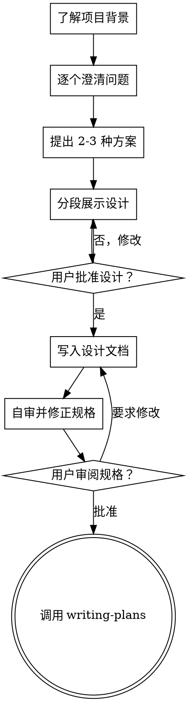

# 从想法到设计

通过自然的协作对话，把模糊想法整理成完整的设计和规格说明。

先了解当前项目，再一次只问一个问题来收敛目标。确认已经理解要做的事情后，提出 2-3 种方案及取舍，分段展示设计，取得用户批准后才进入计划阶段。

<HARD-GATE>
在展示设计并获得用户批准前，不得调用实现类 skill、编写代码、搭建项目或执行任何实现动作。无论项目看起来多简单，都必须遵守。
</HARD-GATE>

## 不要用“这太简单了”跳过设计

待办事项、单函数工具和配置改动同样需要走流程。简单项目可以只写几句话，但必须先暴露假设并得到确认。

## 必须完成的清单

按顺序完成以下事项：

1. **了解项目背景**：检查文件、文档和近期提交。
2. **在合适的时机提供可视化助手**：第一次遇到用图比文字更清楚的问题时再提供，不要一开始就提供。没有视觉问题就不要提供。详见下方“可视化助手”。
3. **逐个提出澄清问题**：理解目的、约束和成功标准。
4. **提出 2-3 种方案**：说明取舍并给出推荐。
5. **展示设计并取得批准**：按复杂度分段，用户确认后再继续。
6. **编写设计文档**：保存到 `docs/superpowers/specs/YYYY-MM-DD-<topic>-design.md` 并提交。
7. **自审规格**：检查占位符、矛盾、歧义和范围。
8. **请求用户审阅文档**：等待用户确认或修改意见。
9. **进入实现准备**：调用 `writing-plans` skill 编写实现计划。

## 流程

流程终点是调用 `writing-plans`。在此之后不要调用前端设计或其他实现 skill。

## 具体做法

### 理解想法

- 先检查项目状态、文件、文档和近期提交。
- 若请求包含多个相互独立的子系统，先指出并拆分，确定依赖关系和实现顺序。
- 对正常范围的项目逐个提问，每条消息只问一个问题；优先使用容易回答的选项题。
- 重点确认目的、约束、用户流程、异常情况和验收标准。

### 探索方案

提出 2-3 种可行方案，先给推荐方案，再说明各方案的复杂度、风险、可维护性和扩展代价。推荐应基于当前代码库，而不是抽象偏好。

### 展示设计

按复杂度分段展示，单个复杂部分控制在约 200-300 字以内。至少覆盖架构、组件边界、数据流、错误处理和测试策略。每段后确认用户是否认可；不清楚就回到澄清阶段。

### 设计边界

把系统拆成职责单一、接口明确、可独立理解和测试的单元。对于每个单元，都应能回答：它做什么、如何使用、依赖什么。现有代码的问题只有在会影响当前工作时才纳入设计，避免无关重构。

## 设计完成后

将确认后的设计写入 `docs/superpowers/specs/YYYY-MM-DD-<topic>-design.md`。写完后检查：

1. 是否还有 `TBD`、`TODO`、未完成段落或含糊要求。
2. 各部分是否一致，架构是否支持描述的功能。
3. 范围是否适合一份实现计划，必要时继续拆分。
4. 每条要求是否只有一种合理解释；有歧义时明确选择。

自审通过后，请用户审阅该文件，明确等待用户批准。用户要求修改时，修改文档并再次自审。只有确认后才调用 `writing-plans`。

## 可视化助手

可视化助手适合展示线框图、流程图、界面对比和其他真正的视觉内容。第一次遇到此类问题时，单独发送以下邀请，不要同时附带其他问题：

> “下一部分用图展示可能更清楚。我可以在浏览器中制作线框图、流程图和对比稿，供我们边看边讨论；这会增加一些时间和 token。需要我打开吗？”

用户同意后，先阅读 `visual-companion.md`，并在用户批准使用后通过 `start-server.sh --open` 启动。概念性问题、需求取舍和文本选项仍使用终端。
